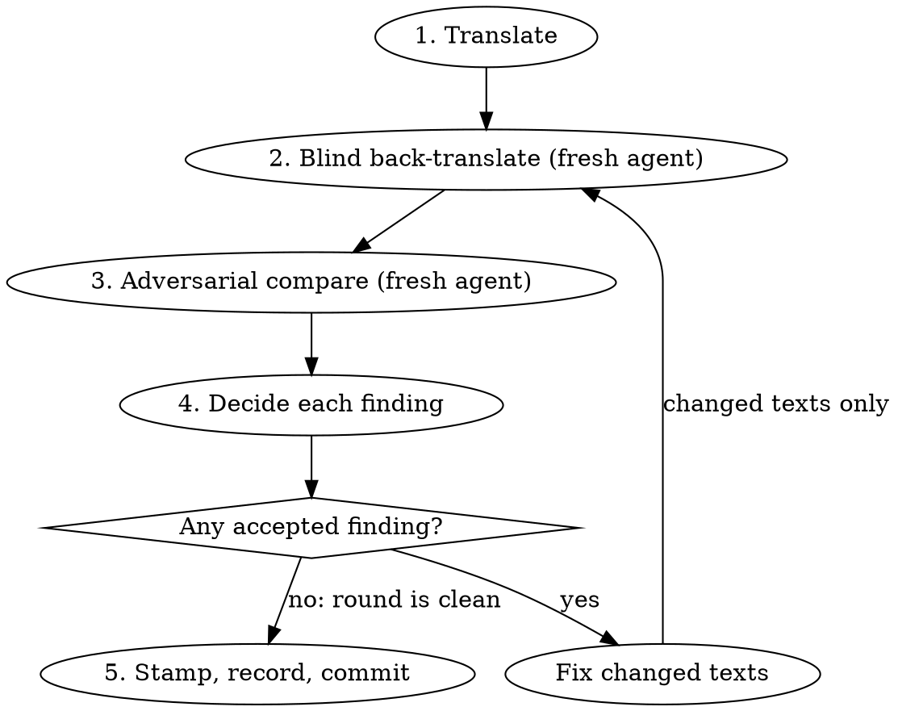

# Verifying translations

**No translation is accepted until it has passed adversarial reverse
translation.** A translation that has not been through the loop below is a
draft. It is not committed, stamped, or presented as done.

Violating the letter of this process is violating its spirit. "I checked it
another way" is not this process.

## What counts as translation work

Any change that puts non-English text in front of a reader, or accepts existing
non-English text against new English:

| Surface                                              | Where                                                                                              |
| ---------------------------------------------------- | -------------------------------------------------------------------------------------------------- |
| App and package UI catalogs                          | `apps/*/src/locales/<tag>.json`, `packages/*/src/locales/<tag>.json`                               |
| Re-accepting a translation after its English changed | catalog guard failure → `i18n:stamp` (see `packages/app-i18n/README.md`, "Translation provenance") |
| Website and documentation messages                   | `apps/networkcanvas.com/messages/`, `apps/documentation/messages/`                                 |
| Website content                                      | `apps/networkcanvas.com/content/**/<id>.<locale>.md`                                               |
| Protocol text                                        | per-locale values in a protocol's `localization` (templates, samples, fixtures users see)          |
| A new language anywhere                              | all of the above                                                                                   |

One string, one locale, or a one-word fix is still translation work. Size does
not change the rule.

English variants (`en-GB`, `en-US`) are spelling localization, not translation;
they are out of scope. Removing a message or renaming an id without changing
any text is out of scope.

## The loop

Three different agents. The translator may be you; the other two are always
fresh subagents.

**Fresh means no inherited conversation.** A subagent that starts with your
transcript has seen the English and your reasoning, and the check is void.

| Harness     | Start a fresh reviewer with                                                          |
| ----------- | ------------------------------------------------------------------------------------ |
| Claude Code | the Agent tool with a named `subagent_type` (e.g. `general-purpose`), never `fork`   |
| Codex       | `spawn_agent` with `fork_turns: "none"` (the default `"all"` copies your transcript) |

Each reviewer's prompt then carries only the inputs its step allows.

### Context notes

Every English text needs a **context note**: where it appears, who reads it
(participant or researcher), and what it refers to. The translator and the
comparator both get it; the back-translator never does.

| Surface                                     | Context note comes from                                                                                               |
| ------------------------------------------- | --------------------------------------------------------------------------------------------------------------------- |
| app-i18n catalogs                           | the message's `description`; if it is missing, add one to the source descriptor first (the catalog guards require it) |
| next-intl messages (website, documentation) | no descriptor exists: write the note from the component that renders the key                                          |
| Markdown content, protocol localization     | write the note from the surrounding document or stage (heading, prompt, the question an answer option belongs to)     |

Notes written by hand go in the comparator prompt and in the PR's verification
section, so a reviewer can see what the comparator was told.

### 1. Translate

Inputs: the English, its context note, and the existing translations for that
locale on the same surface (grep them for the same concepts). Match their
register (formal/informal "you") and terminology. Keep ICU placeholders,
plural/select branches, rich-text tags and Markdown structure intact.

### 2. Blind back-translate

A fresh agent translates the target text back into English. What it receives
decides whether the check means anything:

| Gives it                                                                  | Never gives it                                                                     |
| ------------------------------------------------------------------------- | ---------------------------------------------------------------------------------- |
| The source language's name and the target-language text, ICU intact       | The English source, or any paraphrase or gist of it                                |
| An opaque id (`t01`, `t02`, …)                                            | Real message ids or keys (`interview.passphrase.locked` is the meaning in English) |
| The UI element kind: button, heading, error message, answer option        | Context notes or `description`s (they are English and explain the meaning)         |
| For an answer option, the question it answers, **in the target language** | Earlier translations or earlier back-translations                                  |

Ask for a literal back-translation plus a note on anything ambiguous or unclear.

### 3. Adversarial compare

A different fresh agent, not the translator and not the back-translator,
receives the English, the context note, the translation, and the
back-translation **with the back-translator's notes, pasted verbatim**, never
summarized by you, since you are the one being checked. Instruct it to find
problems, not to confirm quality. It reports each finding with severity and a
proposed fix:

- meaning drift, omission or addition
- ambiguity: the back-translation could mean something the English does not
- register and terminology inconsistent with that locale's existing translations
- ICU parity: placeholders, every plural/select branch
- UI fit: length, truncation risk, tone for the audience (participant or researcher)

### 4. Decide

Accept or reject every finding, with a one-line reason. When the back-translator
and comparator both trip on the same thing, suspect the English: fix it at the
source (through the provenance flow for app-i18n catalogs) and retranslate.

Fixed texts go back through steps 2 and 3 with **fresh** agents. Repeat until a
round has zero accepted findings. A clean round is a comparator report, not your
own reading.

### 5. Stamp, record, commit

Only now run `i18n:stamp` (app-i18n catalogs). Stamping records which English a
translation was made from; it says nothing about whether the translation is
right.

The PR description gets a verification section: a rounds table per language
(findings per round down to zero), the register chosen, hand-written context
notes, findings kept on purpose and why, and a request for native-speaker
review. Reverse translation does not replace a native speaker; a native speaker
does not replace this loop.

## Batching

Batch by language: one back-translator and one comparator per language per
round, run in parallel in the background. Twenty strings across eight languages
is sixteen short agent runs, a few minutes of wall-clock time.

## Rationalizations

| Excuse                                                 | Reality                                                                                                                        |
| ------------------------------------------------------ | ------------------------------------------------------------------------------------------------------------------------------ |
| "They're short strings / the release is in 20 minutes" | The loop takes minutes. Short UI strings are where one wrong word flips meaning.                                               |
| "I'll compare the back-translation myself"             | You wrote the translation and know what it should say. The comparator must be fresh.                                           |
| "I back-translated it in my own context"               | Not blind. You cannot un-know the English.                                                                                     |
| "The back-translator needs context to be accurate"     | Context that carries the meaning is the English by another route. Give the element kind only.                                  |
| "The guard is green / I stamped it"                    | The guard proves freshness, not meaning.                                                                                       |
| "The existing translations here were never verified"   | Unverified precedent is not permission.                                                                                        |
| "One round came back clean on my read"                 | Clean means a fresh comparator found nothing you accepted.                                                                     |
| "A native speaker will review the PR"                  | Request that too. It does not replace the loop.                                                                                |
| "The user said just get them in"                       | Urgency is not a waiver. Only an explicit user instruction to skip verification is; then the PR states the text is unverified. |

## Red flags — stop and run the loop

- About to commit or stamp a translation no fresh comparator has seen
- A back-translator prompt that contains English beyond the element kind
- Real message ids, keys, context notes or `description`s in the back-translator's input
- A reviewer spawned with your conversation (`fork`, or Codex's default `fork_turns`)
- Summarizing the back-translator's output for the comparator instead of pasting it
- "Looks right to me" as the comparison step
- Re-running a changed string through the same agents that saw the earlier round
- A PR with new translations and no verification section
