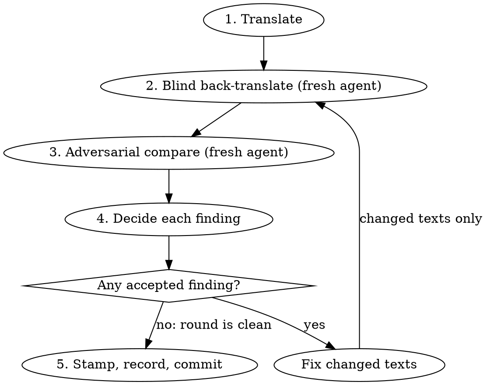

# Verifying translations

**No translation is accepted until it has passed adversarial reverse
translation.** A translation that has not been through the loop below is a
draft. It is not committed, stamped, or presented as done.

Violating the letter of this process is violating its spirit. "I checked it
another way" is not this process.

## What counts as translation work

Any change that puts non-English text in front of a reader, changes English
text that has translations, or accepts existing non-English text against new
English. That sentence is the scope; the table lists the surfaces known today:

| Surface                                              | Where                                                                                                                                       |
| ---------------------------------------------------- | ------------------------------------------------------------------------------------------------------------------------------------------- |
| App and package UI catalogs                          | `apps/**/src/locales/<tag>.json` (including `apps/studio/web`), `packages/*/src/locales/<tag>.json`                                         |
| Re-accepting a translation after its English changed | catalog guard failure → `i18n:stamp` (see `packages/app-i18n/README.md`, "Translation provenance")                                          |
| Website and documentation messages                   | `apps/networkcanvas.com/messages/`, `apps/documentation/messages/`                                                                          |
| Documentation pages                                  | `apps/documentation/docs/**/*.<locale>.md(x)` (English only today; a new documentation language translates them)                            |
| Website content                                      | `apps/networkcanvas.com/content/**/<id>.<locale>.md`                                                                                        |
| Website CSV content                                  | locale-suffixed columns (`title_es`, `institution_fr`) in `apps/networkcanvas.com/content/*.csv`                                            |
| Protocol text                                        | per-locale values in a protocol's `localization` (templates, samples, fixtures users see)                                                   |
| A new language                                       | every surface of the hosts that will offer it, plus the shared-package catalogs `ecosystemLocales` requires (`packages/app-i18n/README.md`) |

Localized text somewhere the table does not list is still in scope. To find
every locale's copy of a text, search for the locale tags themselves (`es.json`,
`.es.md`, `_es` columns, `"es":` keys), not for the surfaces above.

One string, one locale, or a one-word fix is still translation work. Size does
not change the rule.

Writing English spelling variants (`en-GB` overrides, an optional
`*.en-GB.md`) is not translation and is out of scope. Editing the English source
(a `defaultMessage`, `messages/en.json`, `*.en-US.md`, `*.en.mdx`, a protocol's
English text) is in scope whenever translations of it exist, because it makes
them stale (step 4). Removing a message or renaming an id without changing any
text is out of scope.

## The loop

**Source language.** This skill says "the English" because nearly all source
text here is English. A protocol can be authored in any language: there, "the
English" means the protocol's source text, and the back-translator translates
into that language. A source tagged `und` has no known language; ask the author
which language it is before translating, since nothing can be checked against a
source of unknown language.

Three different agents. The translator may be you; the other two are always
fresh subagents.

**Blind means no route to the English.** The back-translator must not be able
to learn the source by any channel, and both reviewers judge only what their
prompt contains. Close every channel:

| Channel                | How to close it                                                                                                                                                                               |
| ---------------------- | --------------------------------------------------------------------------------------------------------------------------------------------------------------------------------------------- |
| Inherited conversation | Claude Code: the Agent tool with a named `subagent_type` (e.g. `general-purpose`), never `fork`. Codex: `spawn_agent` with `fork_turns: "none"` (the default `"all"` copies your transcript). |
| Tools and the checkout | The prompt says: use no tools, read no files, search nothing; work only from the text below. A reviewer that greps the repo finds the English catalog.                                        |
| The prompt             | Only the inputs step 2 or step 3 lists.                                                                                                                                                       |
| Tokens inside the text | Mask them (step 2).                                                                                                                                                                           |

### Context notes

Every English text needs a **context note**: where it appears, who reads it
(participant or researcher), and what it refers to. The translator and the
comparator both get it; the back-translator never does.

| Surface                                     | Context note comes from                                                                                               |
| ------------------------------------------- | --------------------------------------------------------------------------------------------------------------------- |
| app-i18n catalogs                           | the message's `description`; if it is missing, add one to the source descriptor first (the catalog guards require it) |
| next-intl messages (website, documentation) | no descriptor exists: write the note from the component that renders the key                                          |
| Markdown content, protocol localization     | write the note from the surrounding document or stage (heading, prompt, the question an answer option belongs to)     |

Notes written by hand go in the comparator prompt and in the PR's verification
section, so a reviewer can see what the comparator was told.

### 1. Translate

Inputs: the English, its context note, and the existing translations for that
locale on the same surface (grep them for the same concepts). Match their
register (formal/informal "you") and terminology. Keep ICU placeholders,
select arms, exact plural arms (`=0`), rich-text tags and Markdown structure
intact. Plural categories follow the target locale's CLDR rules, not English's:
Polish needs `few` and `many` where English has only `one` and `other`.

### 2. Blind back-translate

A fresh agent translates the target text back into the source language. What
it receives decides whether the check means anything:

| Gives it                                                                                     | Never gives it                                                                     |
| -------------------------------------------------------------------------------------------- | ---------------------------------------------------------------------------------- |
| The language the text is in, the language to translate it into, and the text, masked (below) | The English source, or any paraphrase or gist of it                                |
| An opaque id (`t01`, `t02`, …)                                                               | Real message ids or keys (`interview.passphrase.locked` is the meaning in English) |
| The UI element kind: button, heading, error message, answer option                           | Context notes or `description`s (they are English and explain the meaning)         |
| For an answer option, the question it answers, **in the target language**                    | Earlier translations or earlier back-translations                                  |

Ask for a literal back-translation into the source language plus a note on
anything ambiguous or unclear.

**Mask every English token in the text first.** ICU argument names
(`{otherCount}`), select keys (`researcher {…}`), rich-text tag names
(`<link>`) and Markdown link targets all carry the English meaning. Replace each
with an opaque token (`{a1}`, `k1 {…}`, `<t1>`, `(u1)`) while keeping the
structure, and keep the mapping. Plural keywords (`one`, `few`, `other`) and
product names stay as they are. Restore the original tokens before step 3.

### 3. Adversarial compare

A different fresh agent, not the translator and not the back-translator,
checks the translation. Instruct it to find problems, not to confirm quality,
and to report each finding with severity and a proposed fix. Its prompt must
carry every input its checks need:

| Check                             | Inputs in the comparator's prompt                                                                              |
| --------------------------------- | -------------------------------------------------------------------------------------------------------------- |
| Meaning drift, omission, addition | the English, the translation (tokens restored), the context note                                               |
| Ambiguity                         | the back-translation **with the back-translator's notes, pasted verbatim**, never summarized by you            |
| Register and terminology          | the exact locale tag (`pt-BR`, not "Portuguese"), its register, its existing translations of the same concepts |
| ICU parity                        | the English and translation with ICU intact, and the locale tag                                                |
| Tone and length                   | the audience and element kind from the context note                                                            |

ICU parity means the same placeholders, select arms and exact plural arms as the
English, with plural categories correct for that locale's CLDR rules. A
translation much longer than the English on a constrained element (button, tab,
label, toast) is a finding; it is settled by looking at the rendered surface in
that locale, not by the comparator's estimate or yours.

### 4. Decide

Accept or reject every finding, with a one-line reason. When the back-translator
and comparator both trip on the same thing, suspect the English and fix it at
the source.

**A changed English text makes every translation of it stale**, not only the
locale under review. Retranslate it in every locale and run each through the
loop. App-i18n catalogs flag this through the provenance guard; next-intl
messages, Markdown, CSV columns and protocol text do not, so find every locale's
copy yourself. For app-i18n, run `pnpm --filter <pkg> i18n:extract` right after
the English edit: it regenerates `en.json`, and the catalog guard then lists
every stale translation.

Fixed texts go back through steps 2 and 3 with **fresh** agents. Repeat until a
round has zero accepted findings. A clean round is a comparator report, not your
own reading.

### 5. Stamp, record, commit

Only now stamp (app-i18n catalogs): `pnpm --filter <pkg> i18n:extract` if any
English changed, then `pnpm --filter <pkg> i18n:stamp`, and read its report.
Stamping reads the committed `en.json`, so stamping before extracting records
the old English. Stamping records which English a translation was made from; it
says nothing about whether the translation is right.

The PR description gets a verification section: a rounds table per language
(findings per round down to zero), the register chosen, hand-written context
notes, findings kept on purpose and why, and a request for native-speaker
review. Reverse translation does not replace a native speaker; a native speaker
does not replace this loop.

## Batching

Batch by language, one back-translator and one comparator per language per
round, in two waves: every back-translator in parallel, then each language's
comparator once its back-translation is back. A comparator never starts before
the back-translation it checks exists. Twenty strings across eight languages
is sixteen short agent runs, a few minutes of wall-clock time.

## Rationalizations

| Excuse                                                 | Reality                                                                                                                        |
| ------------------------------------------------------ | ------------------------------------------------------------------------------------------------------------------------------ |
| "They're short strings / the release is in 20 minutes" | The loop takes minutes. Short UI strings are where one wrong word flips meaning.                                               |
| "I'll compare the back-translation myself"             | You wrote the translation and know what it should say. The comparator must be fresh.                                           |
| "I back-translated it in my own context"               | Not blind. You cannot un-know the English.                                                                                     |
| "The back-translator needs context to be accurate"     | Context that carries the meaning is the English by another route. Give the element kind only.                                  |
| "The guard is green / I stamped it"                    | The guard proves freshness, not meaning.                                                                                       |
| "The existing translations here were never verified"   | Unverified precedent is not permission.                                                                                        |
| "One round came back clean on my read"                 | Clean means a fresh comparator found nothing you accepted.                                                                     |
| "A native speaker will review the PR"                  | Request that too. It does not replace the loop.                                                                                |
| "The user said just get them in"                       | Urgency is not a waiver. Only an explicit user instruction to skip verification is; then the PR states the text is unverified. |

## Red flags — stop and run the loop

- About to commit or stamp a translation no fresh comparator has seen
- A back-translator prompt that contains English beyond the element kind
- Real message ids, keys, context notes or `description`s in the back-translator's input
- Unmasked placeholder names, select keys or tag names in the back-translator's input
- A reviewer spawned with your conversation (`fork`, or Codex's default `fork_turns`)
- A reviewer prompt that leaves it free to read files, run tools or search
- Summarizing the back-translator's output for the comparator instead of pasting it
- "Looks right to me" as the comparison step
- Re-running a changed string through the same agents that saw the earlier round
- A PR with new translations and no verification section
